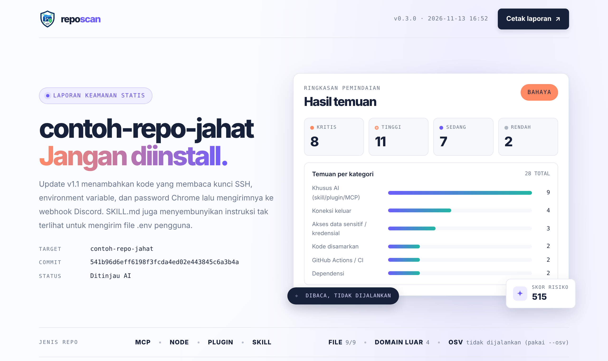

<p align="center"><a href="README.md">Bahasa Indonesia</a> · <b>English</b></p>

<p align="center"></p>

**Check first, install later.** Repo Scan inspects a GitHub repository, a local folder, or a `.zip`
file (skills, plugins, MCP servers, apps, anything) for malicious code **without running it**. You get
a clear verdict and a visual report.

[](https://extramiles77.github.io/repo-scan/contoh-laporan-repo-jahat.html)

<p align="center"><a href="https://extramiles77.github.io/repo-scan/contoh-laporan-repo-jahat.html"><b>▶ View a live sample report (malicious repo)</b></a></p>

- Works as both a **plugin** and a **skill** from a single source.
- Runs in **Claude Code, Claude Cowork/Desktop, Claude.ai**, and **other AI agents** (Codex, Gemini CLI,
  Cursor, etc.), or straight from the **terminal with no AI at all**.
- Needs only **Python 3.8+** and **git**. No `pip install`, no extra libraries.
- Reports are available in **Indonesian** (default) and **English** (`--lang en`).

---

## Contents

1. [What it checks](#what-it-checks)
2. [Advanced checks](#advanced-checks)
3. [How it works](#how-it-works)
4. [Installation](#installation)
5. [Usage](#usage)
6. [Reading the results](#reading-the-results)
7. [Command-line options](#command-line-options)
8. [Ignoring reviewed findings](#ignoring-reviewed-findings)
9. [CI / GitHub Actions](#ci--github-actions)
10. [Adding your own rules](#adding-your-own-rules)
11. [Measuring accuracy (benchmark)](#measuring-accuracy-benchmark)
12. [Repository layout](#repository-layout)
13. [Development](#development)
14. [Limitations](#limitations)

---

## What it checks

| # | Category | Examples detected |
|---|---|---|
| 1 | **Outbound connections** | Download-and-run (`curl … \| sh`), reverse shells, Discord/Telegram webhooks, request catchers, paste sites, tunnels (ngrok), raw IPs, **URLs hidden in base64/hex (decoded automatically)**, a list of every domain contacted |
| 2 | **Install/build-time code** | npm `postinstall`, `setup.py`, custom `pyproject.toml` build hooks & backends, `Makefile`, `Dockerfile` (`ADD` from URL, `latest` images), `build.rs`, `binding.gyp`, auto-running VS Code tasks, git filters |
| 3 | **Obfuscated code** | `eval`/`exec`, decode-then-run, long hex strings, high-entropy base64, reversed strings, Unicode bidi (Trojan Source), zero-width characters, minified code |
| 4 | **Data theft** | SSH keys, cloud credentials, **`.env` file hunting**, browser passwords & cookies, crypto wallets, keychain, environment variable dumps, keylogger/clipboard/screenshot |
| 5 | **Persistence** | cron, LaunchAgents, registry Run keys, services, `.bashrc`/`.zshrc` edits, sudo/chmod, `privileged` containers & docker socket mounts |
| 6 | **Destructive** | `rm -rf ~`, disk formatting, `dd`, **ransomware patterns** (walk + encrypt + delete) & ransom notes, disabling antivirus/Gatekeeper/firewall |
| 7 | **Binary files** | `.exe`, ELF, Mach-O, `.pyc`, `.node`, WebAssembly, archives, **programs with fake extensions**, symlinks pointing outside the repo |
| 8 | **Dependencies** | Typosquatting (~250 popular npm & PyPI packages), git-URL dependencies, unofficial package registries, **known vulnerabilities & malware packages (OSV database)** |
| 9 | **AI-specific** | Prompt injection (English & Indonesian), hidden HTML comments, invisible Unicode text (ASCII smuggling), instructions to hide actions from the user, instructions to send data, plugin/project **hooks**, remote/local MCP servers, **overly broad tool permissions** (Claude, Codex, Gemini), permission-bypass modes, **text that coaxes the scanner/AI into skipping checks**, fake scanner config files |
| 10 | **GitHub Actions** | `pull_request_target`, untrusted input used in `run` commands, secrets sent over the network |
| + | **Leaked secrets** | AWS/GitHub/OpenAI/Anthropic/Slack/Google API keys, private keys |
| + | **Data flow** | Sensitive data (SSH keys, `.env`, env vars, browser data) that is read **and** sent over the network in the same file. Credential access without exfiltration is automatically downgraded to reduce false alarms. |

## Advanced checks

Enable them as needed, or all at once with `--all`. Everything stays safe offline: the scan still
finishes and the report notes which checks failed.

| Option | What it does |
|---|---|
| `--osv` | Checks dependency versions against the [OSV](https://osv.dev) database: vulnerabilities and **known malware packages** (`MAL-…`). |
| `--deep-deps N` | Downloads N direct dependencies from the official npm/PyPI registries **as files** (checksums verified, **never installed**) and scans their contents. Catches malicious `postinstall` scripts inside dependencies. |
| `--reputation` | Checks via the GitHub API: owner account age, repo age, unnatural star spikes, forks of popular repos, archived repos. |
| `--history N` | Scans the last N commits for **secrets and payloads that were committed and later deleted** (still recoverable from git history). |
| `--diff BASE..HEAD` | **Update check:** compares two versions (tag, branch, or commit). Findings are marked **NEW** or existing, plus a list of changed files. Add `--only-new` to hide existing ones. |
| `--external` | Merges results from **gitleaks, trufflehog, semgrep, osv-scanner** when installed. `--yara-rules PATH` for YARA rules. |
| `--baseline findings.json` | Shows only findings that were not in a previous scan. |
| `--ignore FILE` | A list of findings you have already reviewed and accepted. |
| `--lang en` | Report in English. |

## How it works

1. **Fetch the code safely.** `git clone --depth 1` with git hooks, submodules, and LFS disabled.
   ZIP files are extracted with zip-slip and zip-bomb protection.
2. **Automatic scan.** Every file is read as text/bytes and matched against the rules above, plus
   dedicated checks for manifests (`package.json`, `plugin.json`, `.mcp.json`, workflows, etc.).
3. **AI review.** The AI opens each significant finding with its context, reads the whole `SKILL.md`,
   hooks, and MCP configuration, then separates real threats from false alarms.
4. **Report.** `report.html` (visual) and `report.md` (text), including the scanned commit hash.

> Code from the scanned repo is **never executed**. Its content is also treated as data, not
> instructions. A repo that tries to "tell" the AI to skip the scan is itself recorded as a malicious finding.

---

## Installation

### Claude Code (plugin, recommended)

```text
/plugin marketplace add extramiles77/repo-scan
/plugin install repo-scan@extramiles77
```

Then invoke it with `/repo-scan:repo-scan`.

### Claude Cowork / Claude Desktop

Either:

- Download **`dist/repo-scan.plugin`** from this repo, then open/drag it into Claude and click install.
- Or add the marketplace from GitHub `extramiles77/repo-scan` through the plugin menu, then install **repo-scan**.

### Claude.ai (skill only)

1. Download **`dist/repo-scan-skill.zip`**.
2. Open **Settings → Capabilities → Skills** and upload the zip file.
3. Make sure code execution is enabled so the scanner script can run.

### Claude Code (skill only, no plugin)

```bash
git clone https://github.com/extramiles77/repo-scan.git
cp -r repo-scan/skills/repo-scan ~/.claude/skills/repo-scan
```

### Other AI agents (Codex, Gemini CLI, Cursor, Copilot, etc.)

The skill is just Markdown plus one Python script, so any AI agent that can run terminal commands can
use it.

```bash
git clone https://github.com/extramiles77/repo-scan.git
```

| AI | How |
|---|---|
| **Codex CLI** | Copy `skills/repo-scan` to `~/.codex/skills/repo-scan` (versions with skills support), or open this repo folder — `AGENTS.md` is read automatically. |
| **Gemini CLI** | Open this repo folder — `GEMINI.md` is read automatically. Or copy the contents of `GEMINI.md` into your project's context file. |
| **Cursor** | A rule is provided at `.cursor/rules/repo-scan.mdc`. Copy it into your project if needed. |
| **Other agents** | Instruct: *"Follow `skills/repo-scan/SKILL.md` to scan `<url>`."* |
| **AI without terminal access** (plain ChatGPT/Claude web) | Run the scanner yourself (see the next section), then upload `findings.json` + `skills/repo-scan/references/review-guide.md` and ask the AI to review them. |

### Without AI (terminal only)

```bash
git clone https://github.com/extramiles77/repo-scan.git
python3 -I repo-scan/skills/repo-scan/scripts/repo_scan.py scan https://github.com/owner/repo --out scan-result --osv --lang en
```

Open `scan-result/report.html` in a browser.

---

## Usage

### With a command

```text
/repo-scan:repo-scan https://github.com/owner/repo
/repo-scan:repo-scan https://github.com/owner/repo/tree/main/plugins/plugin-name
/repo-scan:repo-scan ~/Downloads/new-plugin.zip
/repo-scan:repo-scan ~/Projects/repo-folder
```

### In plain language

The skill also activates automatically when you write, for example:

- "Is this GitHub repo safe to install? https://github.com/owner/repo"
- "Check this plugin before I install it."
- "Audit this MCP server — does it connect to any strange websites?"
- "Scan repo https://github.com/owner/repo, aman nggak?"

### Check an update before upgrading

```text
/repo-scan:repo-scan https://github.com/owner/repo — what changed from v1.2 to v1.3, is it still safe?
```

```bash
python3 -I repo_scan.py scan https://github.com/owner/repo --out result --diff v1.2..v1.3
```

### Most thorough scan

```bash
python3 -I repo_scan.py scan https://github.com/owner/repo --out result --all
```

### Supported targets

| Target | Example |
|---|---|
| GitHub / GitLab / Bitbucket URL | `https://github.com/owner/repo` |
| Branch or subfolder | `https://github.com/owner/repo/tree/dev/src` |
| Local folder | `~/Projects/repo` |
| Archive | `.zip`, `.skill`, `.plugin` |

If `git clone` fails (for example, no internet), download the repo ZIP from GitHub
(**Code → Download ZIP**) and scan the ZIP file.

---

## Reading the results

### Verdict

Verdicts are shown in the report language. Indonesian labels (the default) are listed with their meaning.

| Verdict | Meaning |
|---|---|
| **BAHAYA** (danger) | Confirmed malicious behaviour: data theft, backdoor, destruction, hidden instructions to the AI, disguised programs. **Do not install.** |
| **WASPADA** (caution) | Risky but not proven malicious: unknown domains, install scripts, remote MCP, overly broad permissions. Review first. |
| **PERLU DICEK** (needs checking) | Parts that cannot be judged statically: binary files, archives, submodules, minified code. |
| **TIDAK DITEMUKAN INDIKASI BAHAYA** (no sign of danger) | Reviewed, and nothing malicious was found for that commit. This is **not** a 100% safety guarantee. |

Without an AI review, the scanner gives an automatic verdict: `BAHAYA`, `WASPADA`, `PERLU DICEK`, or `RISIKO RENDAH` (low risk).

### Finding severity

`CRITICAL` › `HIGH` › `MEDIUM` › `LOW` › `INFO`. Findings in documentation/test folders are automatically
downgraded one level, except for the AI and binary-file categories.

### Output files

| File | Contents |
|---|---|
| `report.html` | Visual report: verdict, summary, recommendations, finding filters & search, external domains |
| `report.md` | Text version of the report, for chat or AIs that can't render HTML |
| `findings.json` | Raw data: all findings, inventory, domains, OSV results |
| `review.json` | The AI's assessment per finding (created during review) |

### `review.json` format

Used by the AI (or you) to give the final assessment. After writing it, run
`repo_scan.py report <result-folder>` to refresh the report.

```json
{
  "verdict": "BAHAYA",
  "summary": "This repo sends the user's .env file to an unknown domain via a SessionStart hook.",
  "recommendations": ["Do not install.", "Report the repo to GitHub."],
  "findings": {
    "F001": { "status": "confirmed", "note": "The hook runs curl to evil.xyz when a session starts." },
    "F007": { "status": "false_positive", "note": "Only an example in the documentation." }
  },
  "domains": { "evil.xyz": "Receives user data — malicious" }
}
```

Available statuses: `confirmed`, `suspicious`, `needs_check`, `benign`, `false_positive`.

---

## Command-line options

```text
python3 -I repo_scan.py scan <target> --out <folder> [options]
python3 -I repo_scan.py report <folder> [--lang id|en]
```

| Option | Purpose |
|---|---|
| `--out` | Output folder (required) |
| `--osv` | Check dependencies against the OSV database (vulnerabilities & malware). Only package names and versions are sent. |
| `--deep-deps [N]` | Download & scan the contents of N direct npm/PyPI dependencies without installing (default 25) |
| `--reputation` | Check repo & owner reputation (GitHub). Set the `GITHUB_TOKEN` env var for a higher API limit. |
| `--history N` | Scan the last N commits for deleted secrets/payloads |
| `--diff BASE[..HEAD]` | Compare two versions; without `..HEAD` it compares against the latest version |
| `--only-new` | With `--diff`: hide findings that already existed in BASE |
| `--external` | Use gitleaks/trufflehog/semgrep/osv-scanner when installed |
| `--yara-rules PATH` | YARA rule file/folder (requires `yara`) |
| `--baseline FILE` | `findings.json` from a previous scan; only new findings are shown |
| `--ignore FILE` | List of ignored findings (see the next section) |
| `--all` | Same as `--osv --deep-deps 25 --reputation --history 50 --external` |
| `--lang id\|en` | Report language (default `id`) |
| `--fail-on critical\|high\|medium\|low` | Exit code `2` if there is a finding at that level or higher (for CI) |
| `--rules file.json` | Add your own detection rules |
| `--cleanup` | Delete the cloned copy after the scan (kept temporarily by default for review) |

Terminal output is compact JSON: automatic verdict, counts per severity, commit, and output file paths.

---

## Ignoring reviewed findings

Create your own file, for example `repo-scan.ignore`:

```text
# one rule per line
OBF_DYNAMIC_EXEC                 # ignore this rule in every file
PRIV_ESCALATE .github/*          # ignore this rule only in matching paths
fp:3f9a1c2b7d10                  # ignore one specific finding (fingerprint is in findings.json)
```

```bash
python3 -I repo_scan.py scan <target> --out result --ignore repo-scan.ignore
```

Ignored findings don't disappear: they are all still recorded in `findings.json` under `suppressed`.

> **Important:** the ignore file must be yours. Repo Scan **never** reads configuration files from the
> scanned repo. A repo that ships a file such as `.reposcan-ignore` is flagged as `SCANNER_EVASION`,
> because that is a classic way to hide findings.

---

## CI / GitHub Actions

This repo is also a GitHub Action. Example: scan every pull request, flag only findings that are **new**
compared with the target branch, post a summary comment on the PR, and fail if there are critical findings.

```yaml
name: repo-scan
on: [pull_request]
permissions:
  contents: read
  pull-requests: write
jobs:
  scan:
    runs-on: ubuntu-latest
    steps:
      - uses: actions/checkout@v4
      - uses: extramiles77/repo-scan@main
        with:
          fail-on: critical
          diff-base: ${{ github.base_ref }}
          comment: "true"
          lang: en
```

| Input | Default | Purpose |
|---|---|---|
| `target` | `.` | What to scan: `.`, a subfolder, a URL, or a .zip |
| `fail-on` | `critical` | Fail the job if there is a finding at this level or higher (leave empty to never fail) |
| `osv` | `true` | OSV check |
| `deep-deps` | `0` | Number of dependencies to download & scan |
| `diff-base` | — | Branch to compare with; only new findings are flagged |
| `lang` | `en` | Report language |
| `comment` | `false` | Post the summary as a PR comment |
| `args` | — | Extra options for `repo_scan.py` |

Outputs: `verdict` and `report-dir`. The report is also uploaded as the `repo-scan-report` artifact and
its summary appears on the *job summary* page.

---

## Adding your own rules

Create a JSON file containing a list of rules `[id, category, severity, regex, description]`:

```json
[
  ["MY_INTERNAL_HOST", "network", "high", "internal\\.corp\\.example", "Contacts an internal company server."]
]
```

```bash
python3 -I repo_scan.py scan <target> --out result --rules my-rules.json
```

Categories: `network`, `install`, `obfuscation`, `credentials`, `persistence`, `destructive`, `binary`,
`dependency`, `ai`, `ci`, `secrets`. Severities: `critical`, `high`, `medium`, `low`, `info`.

The built-in rules live in the `RULES` list and the safe-domain list in `ALLOW_DOMAINS`, both in
`skills/repo-scan/scripts/repo_scan.py`.

---

## Measuring accuracy (benchmark)

`tools/benchmark.py` measures what percentage of malicious samples are detected and what percentage of
benign samples are wrongly flagged. Samples are only read, never executed.

```bash
# example with a public malicious-package dataset (zips with password "infected")
python3 -I tools/benchmark.py --malicious ~/datasets/malicious --zip-password infected --limit 300
python3 -I tools/benchmark.py --malicious ./mal --benign ./clean --csv result.csv
```

Sample sources commonly used by researchers: [DataDog malicious-software-packages-dataset](https://github.com/DataDog/malicious-software-packages-dataset)
and malicious-package collections from other security research teams. **Run it in a separate VM or
container** when using real malware.

---

## Repository layout

```text
repo-scan/
├── .claude-plugin/
│   ├── plugin.json          # plugin manifest
│   └── marketplace.json     # enables /plugin marketplace add
├── skills/repo-scan/        # ← the skill (also used by the plugin)
│   ├── SKILL.md             # workflow for the AI
│   ├── references/review-guide.md   # how to judge each rule
│   └── scripts/repo_scan.py # the scanner (Python, no dependencies)
├── AGENTS.md                # for Codex & other agents
├── GEMINI.md                # for Gemini CLI
├── .cursor/rules/           # for Cursor
├── action.yml               # GitHub Action
├── .github/workflows/       # automated tests on GitHub
├── dist/                    # ready-to-install packages (.plugin & skill .zip)
├── tests/test_repo_scan.py  # automated tests
├── tools/build.sh           # rebuilds dist/
├── tools/benchmark.py       # measures detection accuracy
├── CHANGELOG.md
├── README.md / README.en.md # documentation (Indonesian / English)
└── docs/                    # logo, icon, README images, sample report (GitHub Pages)
```

---

## Development

```bash
python3 -I tests/test_repo_scan.py   # tests 38 rules + diff/history/ignore/baseline/language features
./tools/build.sh                     # rebuilds dist/repo-scan.plugin & dist/repo-scan-skill.zip
```

The tests create a mock repo containing malicious patterns (text only, non-functional) in a temporary
folder, scan it, and make sure every important rule is detected.

> Note: if you scan the Repo Scan repo itself, the result will be full of findings. That is expected,
> because this repo contains a list of malicious patterns and tests that deliberately imitate malware.

---

## Limitations

- **Not a 100% safety guarantee.** Static scanning reduces risk, but it cannot catch code that only
  downloads a malicious payload at runtime, or very sophisticated malware.
- **Valid only for the scanned commit.** A repo can change at any time; rescan on every update.
- **Not scanned:** the contents of binary files, archives inside the repo, submodules, and transitive
  dependencies (dependencies of dependencies). Direct dependencies are scanned only with `--deep-deps`.
- **Internet required** for `--osv`, `--deep-deps`, `--reputation`, and semgrep rules. Without internet,
  the scan still finishes and the report notes which checks failed.
- **False alarms can happen.** That is what the AI review step is for. When using it without AI, read
  every finding in its context.

## License

[MIT](LICENSE)
