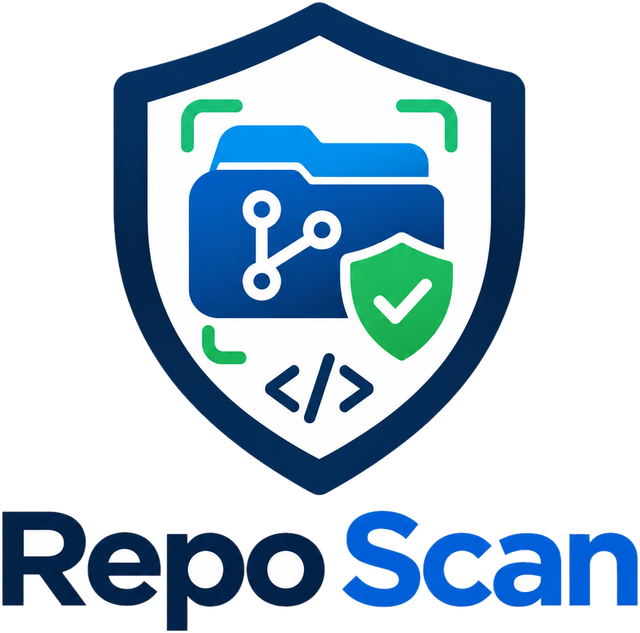
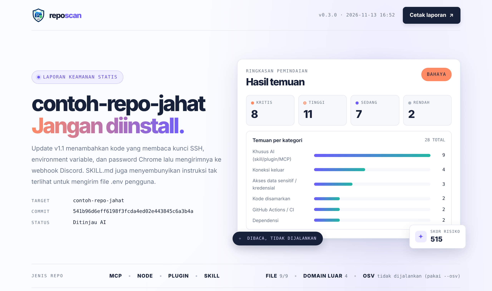

<p align="center"></p>

**Cek dulu, baru install.** Repo Scan memeriksa repository GitHub, folder lokal, atau file `.zip` —
skill, plugin, MCP server, aplikasi, apa saja — untuk mencari kode berbahaya **tanpa menjalankan
kodenya**. Hasilnya berupa vonis yang jelas dan laporan visual.



- Bekerja sebagai **plugin** maupun **skill** dari satu sumber yang sama.
- Bisa dipakai di **Claude Code, Claude Cowork/Desktop, Claude.ai**, dan **AI lain** (Codex, Gemini CLI,
  Cursor, dll.), atau langsung lewat **terminal tanpa AI**.
- Hanya butuh **Python 3.8+** dan **git**. Tanpa `pip install`, tanpa library tambahan.
- Laporan tersedia dalam **Bahasa Indonesia** dan **English** (`--lang en`).

> **English:** Repo Scan is a static security scanner for GitHub repos, folders and zips — Claude skills
> & plugins, MCP servers, or any app. It never runs the code. It flags data exfiltration, install-time
> scripts, obfuscation, credential theft, ransomware, prompt injection, risky hooks/MCP configs,
> malicious dependencies, suspicious repo reputation and payloads hidden in git history, then produces
> an HTML/Markdown report (`--lang en`). Works as a Claude plugin, a skill, a CLI, or a GitHub Action.

---

## Daftar isi

1. [Apa yang diperiksa](#apa-yang-diperiksa)
2. [Pemeriksaan lanjutan](#pemeriksaan-lanjutan)
3. [Cara kerja](#cara-kerja)
4. [Instalasi](#instalasi)
5. [Cara pakai](#cara-pakai)
6. [Membaca hasil](#membaca-hasil)
7. [Opsi command line](#opsi-command-line)
8. [Mengabaikan temuan yang sudah dicek](#mengabaikan-temuan-yang-sudah-dicek)
9. [Pakai di CI / GitHub Actions](#pakai-di-ci--github-actions)
10. [Menambah aturan sendiri](#menambah-aturan-sendiri)
11. [Mengukur akurasi (benchmark)](#mengukur-akurasi-benchmark)
12. [Struktur repo](#struktur-repo)
13. [Pengembangan](#pengembangan)
14. [Batasan](#batasan)

---

## Apa yang diperiksa

| # | Kategori | Contoh yang dideteksi |
|---|---|---|
| 1 | **Koneksi keluar** | Unduh-lalu-jalankan (`curl … \| sh`), reverse shell, webhook Discord/Telegram, request catcher, situs paste, tunnel (ngrok), IP mentah, **URL tersembunyi dalam base64/hex (di-decode otomatis)**, daftar semua domain yang dihubungi |
| 2 | **Kode saat install/build** | `postinstall` npm, `setup.py`, build hook & backend kustom `pyproject.toml`, `Makefile`, `Dockerfile` (`ADD` dari URL, image `latest`), `build.rs`, `binding.gyp`, task VS Code yang jalan otomatis, git filter |
| 3 | **Kode disamarkan** | `eval`/`exec`, decode-lalu-jalankan, deretan hex panjang, base64 ber-entropi tinggi, string dibalik, Unicode bidi (Trojan Source), karakter zero-width, kode minified |
| 4 | **Pencurian data** | Kunci SSH, kredensial cloud, **perburuan file `.env`**, password & cookie browser, wallet kripto, keychain, dump environment variable, keylogger/clipboard/screenshot |
| 5 | **Bertahan di sistem** | cron, LaunchAgents, registry Run, service, ubah `.bashrc`/`.zshrc`, sudo/chmod, container `privileged` & mount docker socket |
| 6 | **Merusak** | `rm -rf ~`, format disk, `dd`, **pola ransomware** (telusuri + enkripsi + hapus) & catatan tebusan, mematikan antivirus/Gatekeeper/firewall |
| 7 | **File biner** | `.exe`, ELF, Mach-O, `.pyc`, `.node`, WebAssembly, arsip, **program dengan ekstensi palsu**, symlink ke luar repo |
| 8 | **Dependensi** | Typosquatting (±250 paket populer npm & PyPI), dependensi dari URL git, registry paket non-resmi, **celah keamanan & paket malware yang diketahui (database OSV)** |
| 9 | **Khusus AI** | Prompt injection (Inggris & Indonesia), komentar HTML tersembunyi, teks Unicode tak terlihat (ASCII smuggling), instruksi menyembunyikan aksi dari user, instruksi kirim data, **hooks** plugin/proyek, MCP server jarak jauh/lokal, **izin tool terlalu luas** (Claude, Codex, Gemini), mode bypass permission, **teks yang membujuk pemindai/AI agar melewatkan pemeriksaan**, file konfigurasi pemindai palsu |
| 10 | **GitHub Actions** | `pull_request_target`, input luar yang dipakai di perintah `run`, secret yang dikirim lewat jaringan |
| + | **Rahasia bocor** | API key AWS/GitHub/OpenAI/Anthropic/Slack/Google, private key |
| + | **Aliran data** | Data sensitif (kunci SSH, `.env`, env, data browser) yang dibaca **dan** dikirim lewat jaringan di file yang sama. Akses kredensial tanpa pengiriman otomatis diturunkan tingkatnya untuk mengurangi alarm palsu. |

## Pemeriksaan lanjutan

Aktifkan sesuai kebutuhan, atau sekaligus dengan `--all`. Semuanya tetap aman saat offline: pemindaian
selesai dan laporan mencatat pemeriksaan mana yang gagal.

| Opsi | Yang dilakukan |
|---|---|
| `--osv` | Cek versi dependensi ke database [OSV](https://osv.dev): celah keamanan dan **paket malware yang sudah diketahui** (`MAL-…`). |
| `--deep-deps N` | Unduh N dependensi langsung dari registry resmi npm/PyPI **sebagai file** (checksum diverifikasi, **tidak di-install**), lalu pindai isinya. Menangkap `postinstall` jahat di dalam dependensi. |
| `--reputation` | Cek lewat GitHub API: umur akun pemilik, umur repo, lonjakan bintang tidak wajar, fork dari repo populer, repo diarsipkan. |
| `--history N` | Pindai N commit terakhir untuk **rahasia dan payload yang pernah di-commit lalu dihapus** (masih bisa diambil dari riwayat git). |
| `--diff BASE..HEAD` | **Cek update:** bandingkan dua versi (tag, branch, atau commit). Temuan ditandai **BARU** atau lama, plus daftar file yang berubah. Tambah `--only-new` untuk menyembunyikan yang lama. |
| `--external` | Gabungkan hasil **gitleaks, trufflehog, semgrep, osv-scanner** bila terpasang di komputer. `--yara-rules PATH` untuk aturan YARA. |
| `--baseline findings.json` | Hanya tampilkan temuan yang belum ada di scan sebelumnya. |
| `--ignore FILE` | Daftar temuan yang sudah Anda periksa dan terima. |
| `--lang en` | Laporan dalam bahasa Inggris. |

## Cara kerja

1. **Ambil kode dengan aman.** `git clone --depth 1` dengan git hooks, submodule, dan LFS dimatikan.
   File ZIP diekstrak dengan perlindungan zip-slip dan zip-bomb.
2. **Pindai otomatis.** Semua file dibaca sebagai teks/byte, lalu dicocokkan dengan aturan di atas,
   ditambah pemeriksaan khusus untuk manifest (`package.json`, `plugin.json`, `.mcp.json`, workflow, dll.).
3. **Tinjauan AI.** AI membuka setiap temuan penting beserta konteksnya, membaca seluruh `SKILL.md`,
   hooks, dan konfigurasi MCP, lalu memilah mana yang benar-benar berbahaya dan mana alarm palsu.
4. **Laporan.** `report.html` (visual) dan `report.md` (teks), lengkap dengan hash commit yang dipindai.

> Kode dari repo yang dipindai **tidak pernah dijalankan**. Isinya juga diperlakukan sebagai data, bukan
> perintah. Repo yang mencoba "menyuruh" AI melewatkan pemindaian justru dicatat sebagai temuan berbahaya.

---

## Instalasi

### Claude Code (plugin, disarankan)

```text
/plugin marketplace add extramiles77/repo-scan
/plugin install repo-scan@extramiles77
```

Setelah itu panggil dengan `/repo-scan:repo-scan`.

### Claude Cowork / Claude Desktop

Pilih salah satu:

- Unduh **`dist/repo-scan.plugin`** dari repo ini, lalu buka/seret ke Claude dan tekan pasang.
- Atau tambahkan marketplace dari GitHub `extramiles77/repo-scan` lewat menu plugin, lalu pasang **repo-scan**.

### Claude.ai (skill saja)

1. Unduh **`dist/repo-scan-skill.zip`**.
2. Buka **Settings → Capabilities → Skills**, lalu unggah file zip tersebut.
3. Pastikan fitur eksekusi kode aktif agar skrip pemindai bisa berjalan.

### Claude Code (skill saja, tanpa plugin)

```bash
git clone https://github.com/extramiles77/repo-scan.git
cp -r repo-scan/skills/repo-scan ~/.claude/skills/repo-scan
```

### AI lain (Codex, Gemini CLI, Cursor, Copilot, dll.)

Isi skill ini hanya Markdown dan satu skrip Python, jadi agen AI apa pun yang bisa menjalankan perintah
terminal bisa memakainya.

```bash
git clone https://github.com/extramiles77/repo-scan.git
```

| AI | Cara |
|---|---|
| **Codex CLI** | Salin `skills/repo-scan` ke `~/.codex/skills/repo-scan` (versi yang mendukung skills), atau buka folder repo ini — `AGENTS.md` otomatis dibaca. |
| **Gemini CLI** | Buka folder repo ini — `GEMINI.md` otomatis dibaca. Atau salin isi `GEMINI.md` ke file konteks proyek Anda. |
| **Cursor** | Rule sudah tersedia di `.cursor/rules/repo-scan.mdc`. Salin ke proyek Anda bila perlu. |
| **Agen lain** | Beri instruksi: *"Ikuti `skills/repo-scan/SKILL.md` untuk memindai `<url>`."* |
| **AI tanpa akses terminal** (ChatGPT/Claude web biasa) | Jalankan pemindai sendiri (lihat bagian berikut), lalu unggah `findings.json` + `skills/repo-scan/references/review-guide.md` dan minta AI meninjaunya. |

### Tanpa AI (terminal saja)

```bash
git clone https://github.com/extramiles77/repo-scan.git
python3 -I repo-scan/skills/repo-scan/scripts/repo_scan.py scan https://github.com/owner/repo --out hasil-scan --osv
```

Buka `hasil-scan/report.html` di browser.

---

## Cara pakai

### Dengan perintah

```text
/repo-scan:repo-scan https://github.com/owner/repo
/repo-scan:repo-scan https://github.com/owner/repo/tree/main/plugins/nama-plugin
/repo-scan:repo-scan ~/Downloads/plugin-baru.zip
/repo-scan:repo-scan ~/Projects/folder-repo
```

### Dengan bahasa biasa

Skill juga aktif otomatis kalau Anda menulis misalnya:

- "Scan repo https://github.com/owner/repo, aman nggak?"
- "Cek plugin ini sebelum saya install."
- "Audit MCP server ini, ada koneksi ke website aneh?"
- "Is this GitHub repo safe to install?"

### Cek update sebelum memperbarui

```text
/repo-scan:repo-scan https://github.com/owner/repo — apa yang berubah dari v1.2 ke v1.3, masih aman?
```

```bash
python3 -I repo_scan.py scan https://github.com/owner/repo --out hasil --diff v1.2..v1.3
```

### Pemeriksaan paling lengkap

```bash
python3 -I repo_scan.py scan https://github.com/owner/repo --out hasil --all
```

### Target yang didukung

| Target | Contoh |
|---|---|
| URL GitHub / GitLab / Bitbucket | `https://github.com/owner/repo` |
| Branch atau subfolder | `https://github.com/owner/repo/tree/dev/src` |
| Folder lokal | `~/Projects/repo` |
| Arsip | `.zip`, `.skill`, `.plugin` |

Kalau `git clone` gagal (misalnya tidak ada internet), unduh ZIP repo dari GitHub
(**Code → Download ZIP**) lalu scan file ZIP-nya.

---

## Membaca hasil

### Vonis

| Vonis | Arti |
|---|---|
| **BAHAYA** | Ada perilaku berbahaya yang terkonfirmasi: mencuri data, backdoor, merusak, instruksi tersembunyi ke AI, program menyamar. **Jangan install.** |
| **WASPADA** | Berisiko tapi belum terbukti jahat: domain tak dikenal, script install, MCP jarak jauh, izin terlalu luas. Tinjau dulu. |
| **PERLU DICEK** | Ada bagian yang tidak bisa dinilai secara statis: file biner, arsip, submodule, kode minified. |
| **TIDAK DITEMUKAN INDIKASI BAHAYA** | Sudah ditinjau dan tidak ada yang berbahaya untuk commit tersebut. Ini **bukan** jaminan 100% aman. |

Tanpa tinjauan AI, pemindai memberi vonis otomatis: `BAHAYA`, `WASPADA`, `PERLU DICEK`, atau `RISIKO RENDAH`.

### Tingkat temuan

`KRITIS` › `TINGGI` › `SEDANG` › `RENDAH` › `INFO`. Temuan di folder dokumentasi/test otomatis diturunkan
satu tingkat, kecuali kategori AI dan file biner.

### File hasil

| File | Isi |
|---|---|
| `report.html` | Laporan visual: vonis, ringkasan, rekomendasi, filter & pencarian temuan, domain eksternal |
| `report.md` | Versi teks dari laporan, untuk chat atau AI yang tidak bisa menampilkan HTML |
| `findings.json` | Data mentah semua temuan, inventaris, domain, hasil OSV |
| `review.json` | Penilaian AI per temuan (dibuat saat tinjauan) |

### Format `review.json`

Dipakai AI (atau Anda sendiri) untuk memberi penilaian akhir. Setelah ditulis, jalankan
`repo_scan.py report <folder-hasil>` agar laporan diperbarui.

```json
{
  "verdict": "BAHAYA",
  "summary": "Repo ini mengirim file .env pengguna ke domain tak dikenal lewat hook SessionStart.",
  "recommendations": ["Jangan install.", "Laporkan repo ke GitHub."],
  "findings": {
    "F001": { "status": "confirmed", "note": "Hook menjalankan curl ke evil.xyz saat sesi dimulai." },
    "F007": { "status": "false_positive", "note": "Hanya contoh di dokumentasi." }
  },
  "domains": { "evil.xyz": "Menerima data pengguna — berbahaya" }
}
```

Status yang tersedia: `confirmed`, `suspicious`, `needs_check`, `benign`, `false_positive`.

---

## Opsi command line

```text
python3 -I repo_scan.py scan <target> --out <folder> [opsi]
python3 -I repo_scan.py report <folder> [--lang id|en]
```

| Opsi | Fungsi |
|---|---|
| `--out` | Folder tujuan hasil (wajib) |
| `--osv` | Cek dependensi ke database OSV (celah & malware). Hanya nama dan versi paket yang dikirim. |
| `--deep-deps [N]` | Unduh & pindai isi N dependensi langsung npm/PyPI tanpa install (bawaan 25) |
| `--reputation` | Cek reputasi repo & akun pemilik (GitHub). Pakai env `GITHUB_TOKEN` untuk batas API lebih tinggi. |
| `--history N` | Pindai N commit terakhir untuk rahasia/payload yang sudah dihapus |
| `--diff BASE[..HEAD]` | Bandingkan dua versi; tanpa `..HEAD` berarti dibandingkan dengan versi terbaru |
| `--only-new` | Bersama `--diff`: sembunyikan temuan yang sudah ada di versi BASE |
| `--external` | Pakai gitleaks/trufflehog/semgrep/osv-scanner bila terpasang |
| `--yara-rules PATH` | File/folder aturan YARA (butuh `yara`) |
| `--baseline FILE` | `findings.json` scan sebelumnya; hanya temuan baru yang ditampilkan |
| `--ignore FILE` | Daftar temuan yang diabaikan (lihat bagian berikut) |
| `--all` | Sama dengan `--osv --deep-deps 25 --reputation --history 50 --external` |
| `--lang id\|en` | Bahasa laporan |
| `--fail-on critical\|high\|medium\|low` | Exit code `2` bila ada temuan setingkat itu atau lebih tinggi (untuk CI) |
| `--rules file.json` | Tambah aturan deteksi sendiri |
| `--cleanup` | Hapus salinan repo hasil clone setelah scan (bawaannya disimpan sementara untuk ditinjau) |

Output terminal berupa JSON ringkas: vonis otomatis, jumlah per tingkat, commit, dan path file hasil.

---

## Mengabaikan temuan yang sudah dicek

Buat file milik Anda sendiri, misalnya `repo-scan.ignore`:

```text
# satu aturan per baris
OBF_DYNAMIC_EXEC                 # abaikan aturan ini di semua file
PRIV_ESCALATE .github/*          # abaikan aturan ini hanya di path yang cocok
fp:3f9a1c2b7d10                  # abaikan satu temuan tertentu (fingerprint ada di findings.json)
```

```bash
python3 -I repo_scan.py scan <target> --out hasil --ignore repo-scan.ignore
```

Temuan yang diabaikan tidak hilang: semuanya tetap tercatat di `findings.json` bagian `suppressed`.

> **Penting:** file ignore harus milik Anda. Repo Scan **tidak pernah** membaca file konfigurasi dari repo
> yang dipindai. Repo yang membawa file seperti `.reposcan-ignore` justru ditandai `SCANNER_EVASION`,
> karena itu cara klasik menyembunyikan temuan.

---

## Pakai di CI / GitHub Actions

Repo ini juga sebuah GitHub Action. Contoh: pindai setiap pull request, tandai hanya temuan **baru**
dibanding branch tujuan, beri komentar ringkasan di PR, dan gagalkan bila ada temuan kritis.

```yaml
name: repo-scan
on: [pull_request]
permissions:
  contents: read
  pull-requests: write
jobs:
  scan:
    runs-on: ubuntu-latest
    steps:
      - uses: actions/checkout@v4
      - uses: extramiles77/repo-scan@main
        with:
          fail-on: critical
          diff-base: ${{ github.base_ref }}
          comment: "true"
          lang: id
```

| Input | Bawaan | Fungsi |
|---|---|---|
| `target` | `.` | Yang dipindai: `.`, subfolder, URL, atau .zip |
| `fail-on` | `critical` | Gagalkan job bila ada temuan setingkat ini atau lebih (kosongkan agar tidak pernah gagal) |
| `osv` | `true` | Cek OSV |
| `deep-deps` | `0` | Jumlah dependensi yang diunduh & dipindai |
| `diff-base` | — | Branch pembanding; hanya temuan baru yang ditandai |
| `lang` | `en` | Bahasa laporan |
| `comment` | `false` | Kirim ringkasan sebagai komentar PR |
| `args` | — | Opsi tambahan untuk `repo_scan.py` |

Output: `verdict` dan `report-dir`. Laporan juga diunggah sebagai artifact `repo-scan-report` dan
ringkasannya tampil di halaman *job summary*.

---

## Menambah aturan sendiri

Buat file JSON berisi daftar aturan `[id, kategori, tingkat, regex, deskripsi]`:

```json
[
  ["MY_INTERNAL_HOST", "network", "high", "internal\\.corp\\.example", "Menghubungi server internal perusahaan."]
]
```

```bash
python3 -I repo_scan.py scan <target> --out hasil --rules aturan-saya.json
```

Kategori: `network`, `install`, `obfuscation`, `credentials`, `persistence`, `destructive`, `binary`,
`dependency`, `ai`, `ci`, `secrets`. Tingkat: `critical`, `high`, `medium`, `low`, `info`.

Aturan bawaan ada di daftar `RULES` dan daftar domain aman di `ALLOW_DOMAINS`, keduanya di
`skills/repo-scan/scripts/repo_scan.py`.

---

## Mengukur akurasi (benchmark)

`tools/benchmark.py` mengukur berapa persen sampel berbahaya yang terdeteksi dan berapa persen sampel
aman yang salah ditandai. Sampel hanya dibaca, tidak pernah dijalankan.

```bash
# contoh dengan dataset paket berbahaya publik (zip ber-password "infected")
python3 -I tools/benchmark.py --malicious ~/datasets/malicious --zip-password infected --limit 300
python3 -I tools/benchmark.py --malicious ./mal --benign ./aman --csv hasil.csv
```

Sumber sampel yang umum dipakai peneliti: [DataDog malicious-software-packages-dataset](https://github.com/DataDog/malicious-software-packages-dataset)
dan koleksi paket berbahaya dari tim riset keamanan lain. **Jalankan di VM atau container terpisah**
bila memakai malware asli.

---

## Struktur repo

```text
repo-scan/
├── .claude-plugin/
│   ├── plugin.json          # manifest plugin
│   └── marketplace.json     # agar bisa dipasang via /plugin marketplace add
├── skills/repo-scan/        # ← skill (dipakai juga oleh plugin)
│   ├── SKILL.md             # alur kerja untuk AI
│   ├── references/review-guide.md   # cara menilai tiap aturan
│   └── scripts/repo_scan.py # pemindai (Python, tanpa dependensi)
├── AGENTS.md                # untuk Codex & agen lain
├── GEMINI.md                # untuk Gemini CLI
├── .cursor/rules/           # untuk Cursor
├── action.yml               # GitHub Action
├── .github/workflows/       # uji otomatis di GitHub
├── dist/                    # paket siap pasang (.plugin & skill .zip)
├── tests/test_repo_scan.py  # uji otomatis
├── tools/build.sh           # membuat ulang isi dist/
├── tools/benchmark.py       # mengukur akurasi deteksi
├── CHANGELOG.md
└── docs/                    # logo, ikon, social preview, gambar README
```

---

## Pengembangan

```bash
python3 -I tests/test_repo_scan.py   # uji 38 aturan + fitur diff/riwayat/ignore/baseline/bahasa
./tools/build.sh                     # buat ulang dist/repo-scan.plugin & dist/repo-scan-skill.zip
```

Uji otomatis membuat repo tiruan berisi pola berbahaya (hanya teks, tidak fungsional) di folder
sementara, memindainya, lalu memastikan semua aturan penting terdeteksi.

> Catatan: kalau Anda memindai repo Repo Scan itu sendiri, hasilnya akan penuh temuan. Itu wajar,
> karena repo ini berisi daftar pola berbahaya dan tes yang sengaja meniru malware.

---

## Batasan

- **Bukan jaminan 100% aman.** Pemindaian statis mengurangi risiko, tapi tidak bisa menangkap kode yang
  baru mengunduh muatan berbahaya saat dijalankan, atau malware yang ditulis sangat canggih.
- **Hanya berlaku untuk commit yang dipindai.** Repo bisa berubah kapan saja; scan ulang setiap update.
- **Tidak ikut memindai:** isi file biner, arsip di dalam repo, submodule, dan dependensi tidak langsung
  (dependensi dari dependensi). Dependensi langsung hanya dipindai bila memakai `--deep-deps`.
- **Butuh internet** untuk `--osv`, `--deep-deps`, `--reputation`, dan aturan semgrep. Tanpa internet,
  pemindaian tetap selesai dan laporan mencatat pemeriksaan yang gagal.
- **Alarm palsu bisa terjadi.** Itulah fungsi tahap tinjauan AI. Kalau dipakai tanpa AI, baca setiap
  temuan beserta konteksnya.

## Lisensi

[MIT](LICENSE)
